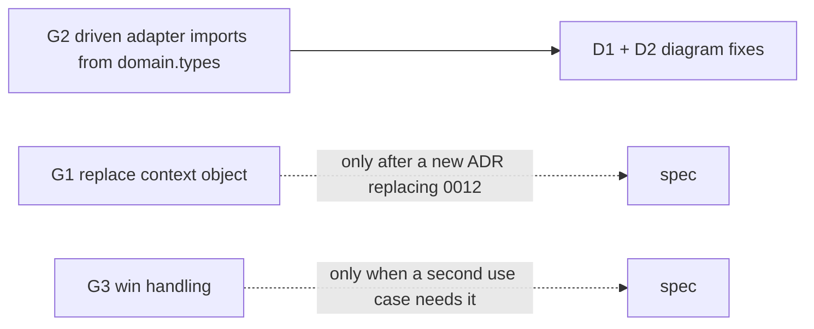

# Hexagonal architecture review: Katacombs game-server (stage 11)

- **Date:** 2026-11-26
- **Revision reviewed:** `378707f` (merge of PR #18). The `brown_field/` code is the same at HEAD `62b82a4`.
- **Scope:** `brown_field/` package, checked against `backend-architecture.html` in this folder
- **Previous review:** `../architecture-backend-hexagon-20261126-123946/hexagonal-review.md` (stage 6)
- **Fitness tests:** `brown_field/tests/fitness` pass (46 passed)
- **Purpose:** input for writing specs for the next refactoring stages

## Summary

This is now a correct hexagonal architecture. The driving side is fixed, and the domain is the innermost ring. What remains are minor smells and two small gaps in the diagram.

| Aspect | Status |
|---|---|
| Dependency direction (`domain < ports < application < adapters < root`) | ✅ Correct (ARCH-1) |
| Outbound ports and swappable adapters | ✅ Correct |
| Pure domain, imports only `domain/` | ✅ Correct (ARCH-7) |
| Driving adapter depends only on inbound ports | ✅ Correct (ARCH-8) |
| Adapter holds no rule and no state | ✅ Correct (ARCH-5) |
| Explicit dependencies per use case | ⚠️ Context object kept (decision 0012) |
| Driven adapters independent of the driving contract | ⚠️ One import from `kata.py` |

## Stage 6 findings, re-checked

| Finding | Status | Evidence |
|---|---|---|
| F1. Inbound ports bypassed | ✅ Fixed | `build_app(ports: InboundPorts)` in `adapters/rest/app.py:98`. Every route calls `ports.<port>.execute(...)`. The adapter imports only `kata` and FastAPI. |
| F2. MOVE-5 gate in the adapter | ✅ Fixed | `PlayerState.ensure_rested()` in `domain/player.py:31` is called first in `MoveUseCase.execute` (`application/use_cases.py:104`). |
| F3. `GameState` does too much | 🟡 Mostly fixed | `password_hash` moved to `domain/accounts.py`. `market_is_cleaning(minute)` moved to `domain/world.py:95`. DTO mapping moved to `application/views.py`. `GameState` is still the context object that each use case takes whole. |
| F4. Domain depends on `kata.py` | ✅ Fixed | Core types live in `domain/types.py`. `kata.py` re-exports them as the same objects (decision 0018). |
| F5. Composition root inheritance | 🟡 Accepted | `default_adapters()` and `inbound_ports(game)` in `game.py` are proper factories. `InMemoryGame` still extends `GameState`, only to keep the frozen name (decision 0008), and its docstring says so. |

## Open findings

### G1. `GameState` is still a service locator

Each use case takes the whole game (decision 0012). So a use case's real dependencies are hidden. Use cases also change the shared state directly.

**Evidence:**
- `application/use_cases.py`. Every use case has `__init__(self, game: GameState)`.
- Direct writes, for example `game.players[...]`, `game.finished_games.append(...)` and `game.places[...].items`.
- `application/state.py:72-160` holds the ports, the aggregates and their lookups.

**Why it matters:** it works for a single in-process game. But there is no seam if the state ever moves out of memory or is shared between processes. It is also harder to see from a use case's signature which ports it uses.

**Recommendation:** leave it as it is unless one of those needs comes up. If it does, write an ADR that replaces 0012 before writing the spec.

**Possible target state (only if an ADR is accepted):**
- Each use case receives only the ports and repositories it uses.
- Player, chat and account state sit behind repository ports instead of public dicts on `GameState`.

**Acceptance criteria (if pursued):**
- No use case constructor takes `GameState`.
- The frozen `XUseCase(game)` names keep working, for example through a factory in `game.py` (decision 0008).
- Invariant and transcript tests stay green.

### G2. A driven adapter imports from the inbound port module

`adapters/files/world_json.py:11` imports `Action`, `Direction` and `Item` from `kata`. They are the same objects as in `domain.types`, so nothing breaks. But a driven adapter has no reason to depend on the driving-side contract.

**Target state:** `world_json.py` imports these types from `domain.types`.

**Acceptance criteria:**
- A fitness test fails if any module under `adapters/` other than `adapters/rest/` imports `kata`.
- The planted-break pattern used by the existing ARCH tests covers the new rule.

**Size:** one import line and one fitness test. It is a good candidate for a small standalone change.

### G3. Win handling is orchestrated inline in `MoveUseCase`

On a win, `MoveUseCase` computes the score, appends to the high-score sink and appends to `finished_games`.

**Evidence:** `application/use_cases.py:116-122`.

**Recommendation:** this is fine in a use case today. Act only if a second use case needs the same steps. Then extract one application helper, or a domain event if more reactions appear. Do not specify it in advance.

## Diagram accuracy

The diagram matches the code, with two gaps.

### D1. Inbound ports are drawn outside the "Core" region

The `Core: application + domain` region wraps `usecases`, `state`, `domain` and `portsout`, but not `kata`. In hexagonal terms the inbound ports are the edge of the hexagon. The repo's own ARCH-1 order (`domain < ports < application < adapters < root`) also places them inside the core. It only looks outside because `kata.py` sits at the package root rather than under `application/`.

**Fix:** add `kata` to the core region in `candidate.json`, or rename the region to "Core: ports + application + domain".

### D2. The composition root's links to driven adapters and `GameState` are missing

`game.py` imports all concrete driven adapters and builds `GameState` through `InMemoryGame` and `default_adapters()`. The diagram only shows `root → rest` (`build_app(ports)`) and `root → usecases` (`inbound_ports(game)`).

**Fix:** add `root → state` (`InMemoryGame(default_adapters())`) and one `root → Driven adapters` link (`default adapters`). That shows the composition root is the only place that knows both sides.

## Suggested order

- G2 is small, independent and can be done now.
- D1 and D2 are regeneration fixes to the diagram source and need no code change.
- G1 and G3 are conditional. Do not write specs for them until the trigger happens.

## Open questions for the specs

- Should the new G2 fitness rule be stricter, so that driven adapters import only `application.ports_out` and `domain`?
- Is there a known future need (persistence of live games, more than one process) that would justify G1 now?
- Should `kata.py` move under `application/` (or a `ports/` package next to `ports_out.py`) so that both port sides sit together? That needs care with the frozen import paths (decision 0008).
