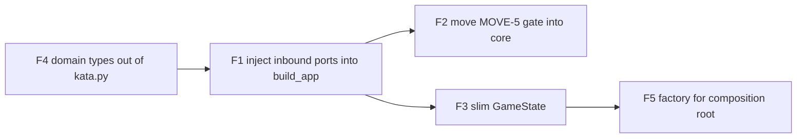

# Hexagonal architecture review: Katacombs game-server (stage 6)

- **Date:** 2026-11-26
- **Revision reviewed:** `86b87a6` (Stage 6, hexagon-6-domain-model)
- **Scope:** `brown_field/` package, checked against `backend-architecture.html` in this folder
- **Purpose:** input for writing specs for the next refactoring stages

## Summary

The diagram matches the code accurately. The architecture is a mostly correct hexagon. The outbound (driven) side is textbook. The inbound (driving) side is only half done, and the core has two smells.

| Aspect | Status |
|---|---|
| Dependency direction (core imports nothing outside) | ✅ Correct |
| Outbound ports and swappable adapters | ✅ Correct |
| Pure domain (no I/O) | ✅ Correct |
| Inbound ports used by the driving adapter | ❌ Declared but bypassed |
| Adapter isolated from core internals | ⚠️ One documented leak (MOVE-5) |
| Domain as the innermost ring | ⚠️ Depends on `kata.py` types |
| Explicit dependencies per use case | ⚠️ God context object |

## What is correct

- **The dependency rule holds.** `application/` and `domain/` import nothing from `adapters/`. They also import no I/O libraries such as `sqlite3`, `os`, `fastapi` or `json`. All adapters import inward only.
- **Outbound ports are proper.** `application/ports_out.py` defines `Clock`, `RandomSource`, `HighScoreSink`, `SaveStore`, `AccountStore` and `WorldSource` as Protocols. The SQLite, file, system and memory adapters implement them, so they can be swapped. The memory adapters show this works for tests.
- **The domain does no I/O.** Even randomness and time come in through ports.
- **There is a composition root.** `game.py` wires one default adapter to each port.
- **A fitness test enforces the rule** (`tests/fitness/test_structure.py`).

## Findings

### F1. Inbound ports are decorative (main issue)

`kata.py` declares 16 inbound port Protocols (`Move`, `RegisterPlayer`, and others), but no code depends on them. The REST adapter imports the concrete classes from `application/use_cases.py` and creates one on every request.

```python
# adapters/rest/app.py
def start_game(body: NewPlayer) -> dict:
    return player_json(RegisterPlayerUseCase(game).execute(body.name))
```

A driving adapter should depend on the port and receive an implementation. Python Protocols are structural, so the "use case satisfies port" relation in the diagram is never used.

**Evidence:**
- `adapters/rest/app.py:15-33` imports `GameState` and every `*UseCase` class.
- `adapters/rest/app.py:105-208` builds the use cases inside each route.

**Target state:**
- `build_app` receives the inbound port implementations, typed as the `kata.py` Protocols. It does not receive `GameState`.
- The composition root (`api.py` / `game.py`) builds the use cases and passes them in.
- `adapters/rest/` imports nothing from `application/`.

**Acceptance criteria:**
- A fitness test fails if `adapters/rest/` imports `application.use_cases` or `application.state`.
- The REST adapter can be tested with fake port implementations and no `GameState`.
- The frozen names (`create_app`, `app`, `InMemoryGame`, use case and error names) stay unchanged (decision 0008).

### F2. The REST adapter reads application state and holds a business rule

The move route reads `game.players` and applies the MOVE-5 energy gate in the adapter. The diagram marks this as the one ARCH-5 exception while ADR 0011 is proposed.

**Evidence:** `adapters/rest/app.py:199-205`.

```python
state = game.players.get(player_sid)
if state is not None and state.energy <= 0:
    return error(405, "YOU ARE TOO TIRED TO MOVE. EAT OR DRINK SOMETHING.")
```

**Target state:**
- The energy gate lives in the domain (`PlayerState`) or in `MoveUseCase`. It raises `NotAllowed` with the same message.
- The existing `KatacombsError` handler maps it to 405, so the HTTP contract stays the same.

**Acceptance criteria:**
- The HTTP status, body and message for a tired player stay byte-identical (check with transcripts / `test_transcripts.py`).
- The route has no reads of `game.*`.
- ADR 0011 is decided or updated to record the move.

**Dependency:** this is easiest after F1, because the adapter then no longer has access to `GameState`.

### F3. `GameState` is a service locator and does too much

Every use case takes the whole `game` (decision 0012). So no use case shows which ports it actually needs. `application/state.py` also mixes several jobs in one object:
- outbound port holder (`clock`, `random_source`, `high_scores`, `save_store`, `account_store`)
- mutable aggregate store (`players`, `chat`, `accounts`, `finished_games`)
- DTO mapping (`to_player`, `to_location`, `to_bag`)
- business rules (`market_is_cleaning`, `password_hash`)

**Evidence:** `application/state.py:37-48` and `application/state.py:84-197`.

**Target state (options for the spec to choose from):**
- Move `market_is_cleaning` to the domain, with the current time passed in as a value.
- Move the DTO mapping (`to_*`) to a separate application mapper.
- Optionally give each use case only the ports and repositories it needs, instead of the whole `GameState`. This conflicts with decision 0012 ("XUseCase(game) reads its ports from the game"), so it needs a new ADR before it is specified.

**Acceptance criteria:**
- `application/state.py` has no game rules.
- Behaviour is unchanged (invariants and transcript tests stay green).

### F4. The domain depends on the inbound port module

`domain/world.py`, `domain/player.py` and `domain/constants.py` import `Item` and `Direction` from `kata.py`. `kata.py` is the inbound API module, but it also holds core types. `Item`, `Bag` and `Player` act as both domain types and API DTOs. The comments in `kata.py` say energy was "added for the ports… the REST adapter reads it here", which shows that coupling.

**Evidence:**
- `domain/world.py:5`, `domain/player.py:9`, `domain/constants.py:7`
- `kata.py` (`Bag.energy`, `Player.energy` comments)

**Target state:**
- `Item`, `Action` and `Direction` are defined in `domain/`.
- `kata.py` re-exports them, so the frozen public names keep working.
- `kata.py` keeps only port contracts and view models (`Player`, `Bag`, `Location`, `ChatLine`, `FinishedGame`, `AccountView`).

**Acceptance criteria:**
- A fitness test fails if `domain/` imports `kata`.
- `from brown_field.kata import Item, Direction` still works.

### F5. Minor: the composition root uses inheritance and a misleading name

`InMemoryGame` extends `GameState` only to supply default adapters. Its defaults are SQLite and files, not memory, so the name is misleading.

**Evidence:** `game.py:73-95`.

**Target state:** a factory function builds `GameState` with the defaults. `InMemoryGame` stays as a frozen name (decision 0008), for example as a thin alias or wrapper.

**Acceptance criteria:** the public `InMemoryGame(...)` keyword signature stays unchanged.

## Suggested order



- F4 and F1 are independent, but doing F4 first keeps the F1 diff smaller.
- F1 has the most impact. It removes the adapter's access to `GameState`, which makes F2 straightforward.
- F3 needs an ADR if it changes decision 0012.
- F5 is cosmetic and can go last.

## Open questions for the specs

- Does ADR 0011 (MOVE-5) get decided as part of F2, or is the gate moved without changing the decision status?
- Does F3 replace decision 0012 (use cases read ports from the game), or only move rules and mappers out of `GameState`?
- Should the REST adapter keep raising domain errors directly (`domain/errors.py`), or should the inbound ports expose their own error types?
